# Fugue — machine-checked proofs

[](https://github.com/rmorleysmith/fugue-formal/actions/workflows/build.yml)
[](LICENSE)
[](lean-toolchain)

Lean 4 proofs, checked against [Mathlib](https://github.com/leanprover-community/mathlib4), of
the mathematics behind the HSLN exploration of 2026: an attempt to build a neural network out
of modular forms, which led straight into classical number theory.

- **About 620 theorems**, of which **103 headline results** are re-checked by
  [`Audit.lean`](Audit.lean).
- **No `sorry`.** Every headline result depends only on Lean's three standard axioms.
- **The mathematics is classical.** What is new is that it is machine-checked, connected to the
  pictures that motivated it, and in several cases not yet in Mathlib at the pinned version
  (for example Jacobi's two-square theorem, `L(1, χ₋₄) = π/4`, and the vanishing of level-one
  forms at the elliptic points).

## From picture to proof

Each figure below comes from the exploration
([rmorleysmith/fugue-exploration](https://github.com/rmorleysmith/fugue-exploration), where the
script that draws it lives). Under each is the theorem it became and the Lean name to cite.

### The landscape

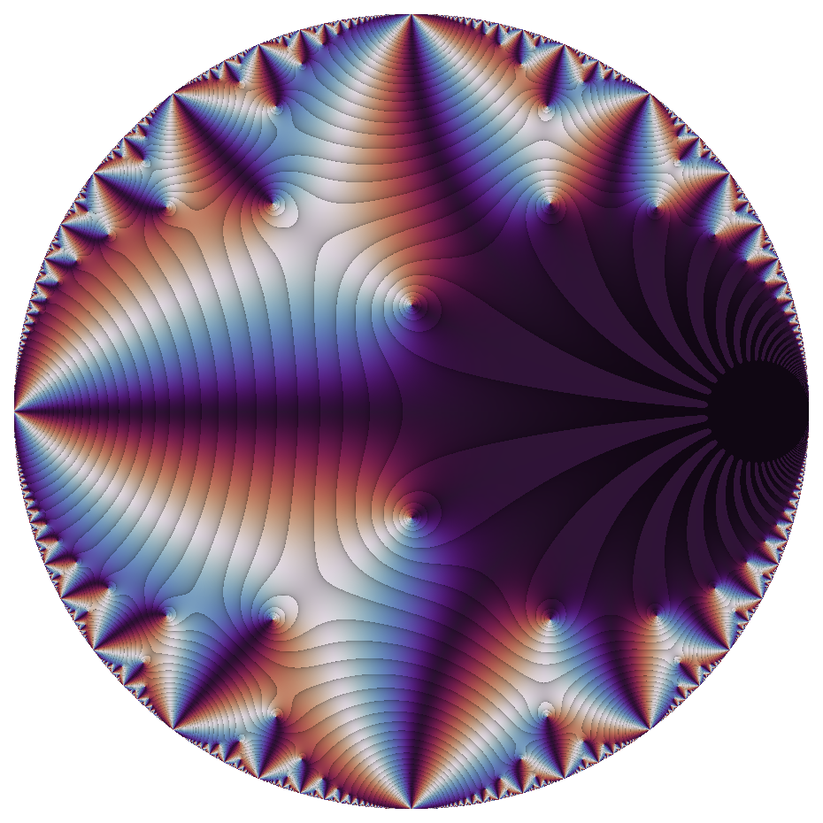

**E₄ has one zero, at ρ.** Drawn by phase on the disk, the Eisenstein series `E₄` vanishes at
`ρ = e^{2πi/3}` and its images, and nowhere else (the classical valence formula; that half is
not formalised here). *Proved:* every level-one modular form of
weight not divisible by 6 vanishes at `ρ`, and of weight not divisible by 4 vanishes at `i`.
`Fugue.eq_zero_at_rho`, `Fugue.eq_zero_at_I`, `Fugue.E₄_rho`

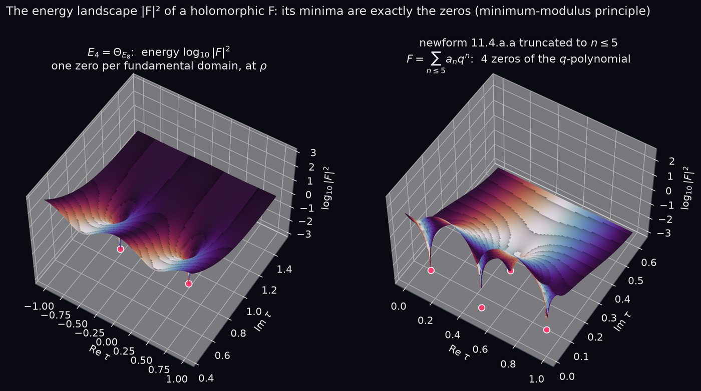

**The valleys are the zeros.** For a holomorphic `F`, the energy `|F|²` has no local minimum
except at a zero of `F`, so a gradient flow on it settles only at zeros. *Proved:* a local
minimum of `|f|` where `f` is not locally constant is a zero, and every zero is a local minimum.
`Fugue.eq_zero_of_isLocalMin_norm`, `Fugue.isLocalMin_norm_of_eq_zero`

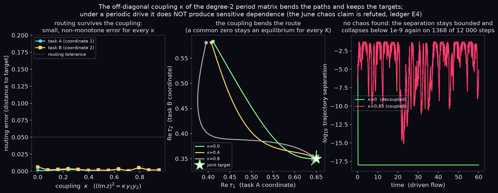

**Coupling two copies.** Two landscapes joined by an off-diagonal coupling `κ` in a 2×2 period
matrix still define a geometry exactly when `|κ| < 1`, and a common zero stays an equilibrium
for any coupling. `Fugue.couplingMatrix_posDef_iff`, `Fugue.equilibrium_preserved`

### The lattice

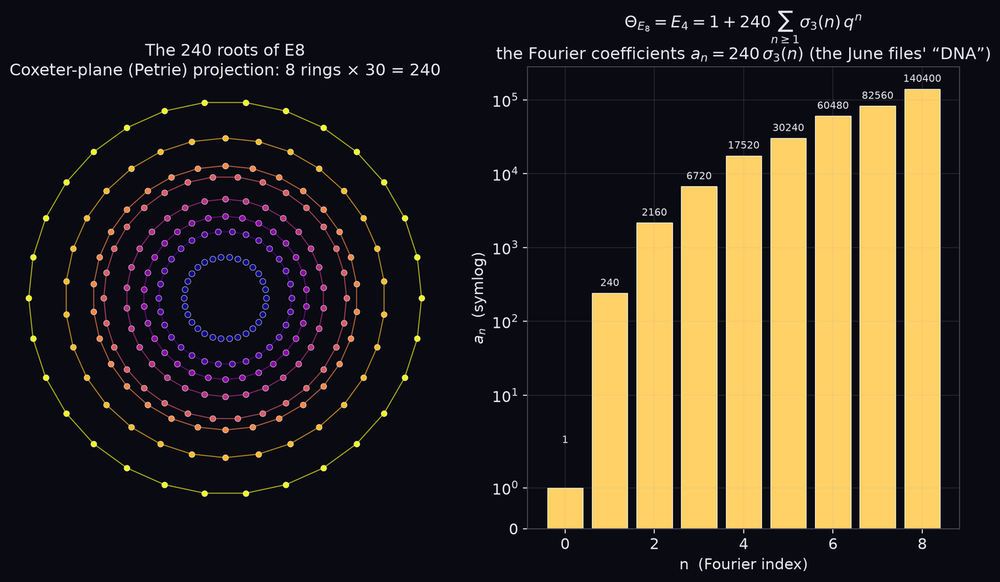

**E8 counts the coefficients of E₄.** Counting vectors of the E8 lattice by length gives 240 of
norm 2, 2160 of norm 4, 6720 of norm 6: the coefficients of `E₄`. *Proved:* `Θ_E8 = E₄`, and the
number of vectors of norm `2n` is `240 σ₃(n)`. `Fugue.thetaE8_eq_E₄`, `Fugue.reprCount_e8`

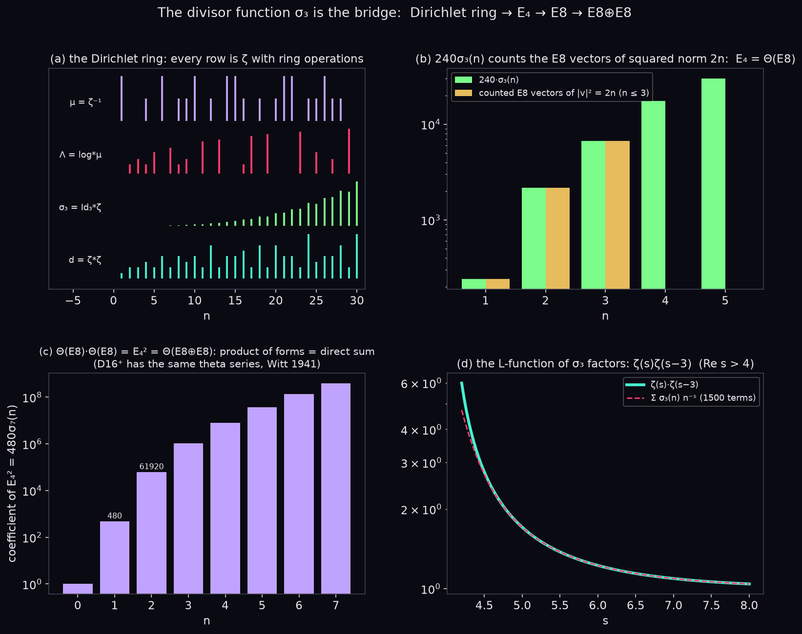

**Two copies: E8 ⊕ E8.** Squaring the theta series counts vectors in `E8 ⊕ E8`: `480 σ₇(n)`.
The lattice `D16⁺` has exactly the same counts (Witt), so the lattices of the two heterotic
string theories cannot be told apart this way. Comparing coefficients gives Ramanujan's
`σ₇(n) = σ₃(n) + 120 Σ σ₃(a) σ₃(n − a)`. `Fugue.thetaE8_sq_eq_E₈`, `Fugue.reprCount_e8e8`,
`Fugue.thetaD16_eq_thetaE8_sq`, `Fugue.sigma_seven_eq`

### Two multiplications on one list of numbers

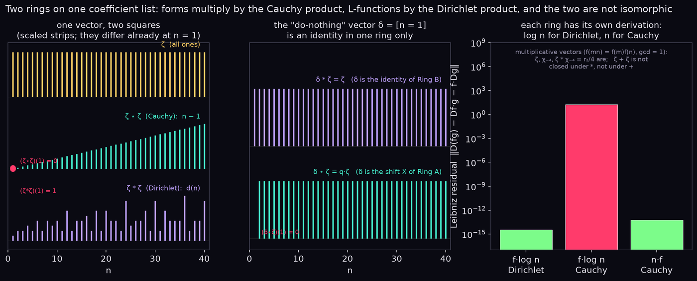

**Same coefficients, different products.** A list of coefficients can be multiplied as a power
series (the Cauchy product) or as a Dirichlet series (the Dirichlet product). The two already
disagree at `n = 1`, and the two rings are not isomorphic. Multiplying by `log n` is a
derivation of the Dirichlet ring. `Fugue.cauchy_ne_dirichlet`, `Fugue.not_ringEquiv_powerSeries`,
`Fugue.pmul_log_mul`

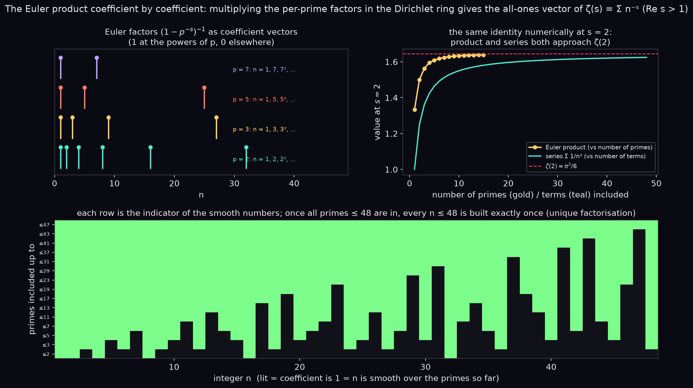

**Building ζ one prime at a time.** Each prime contributes a factor `1 + p⁻ˢ + p⁻²ˢ + …`.
Multiplying them fills in the coefficients of `ζ`. *Proved:* the product of the factors for the
primes in a set `S` is exactly the indicator of the numbers built from `S`, so with the primes up
to `N` every coefficient up to `N` is 1. This is unique factorisation, read coefficient by
coefficient. `Fugue.EulerCompose.prod_eulerFactor`, `Fugue.EulerCompose.prod_eulerFactor_apply_of_le`

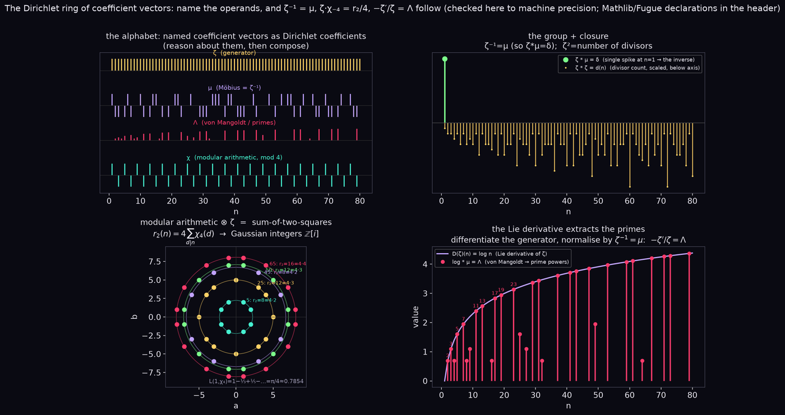

**Arithmetic as algebra.** In the Dirichlet ring, `μ` is the inverse of `ζ` (Mathlib's
`ArithmeticFunction.coe_zeta_mul_moebius`), and `ζ · χ₋₄` counts the ways to write `n` as a sum of
two squares. *Proved:* Jacobi's two-square theorem, `r₂(n) = 4 Σ_{d | n} χ₋₄(d)`.
`Fugue.card_sq_add_sq`

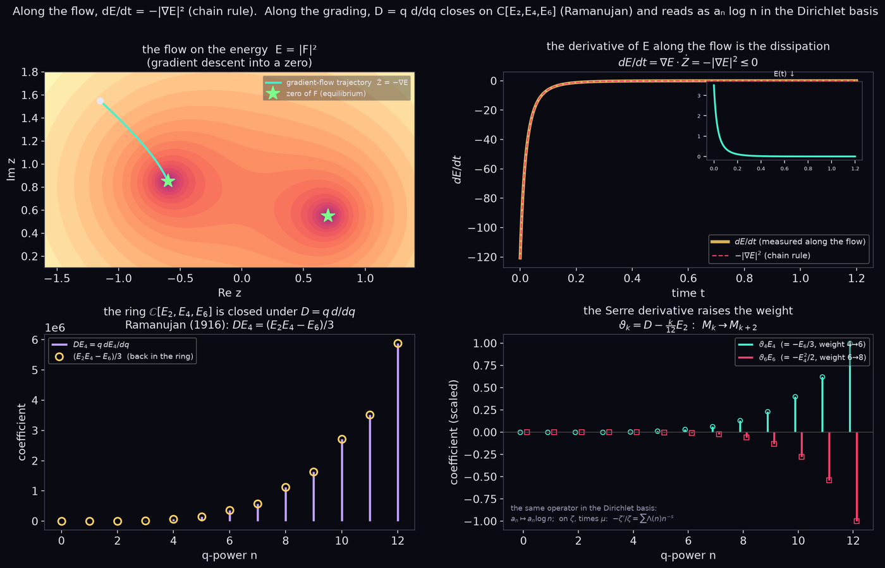

**A derivative that stays in the ring.** Ramanujan's `q d/dq` sends `E₂, E₄, E₆` to polynomials
in themselves, and the Serre derivative raises the weight by 2 (Mathlib:
`normalizedDerivOfComplex_E₄`, `serreDerivative_E₄`). On Dirichlet series the matching
operator, `−d/ds`, multiplies the `n`-th coefficient by `log n`: the derivation above.

### L-functions and primes

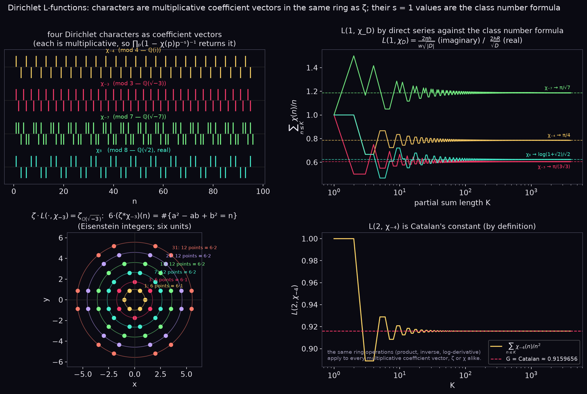

**L-functions as a family.** Twisting `ζ` by a character gives an L-function with an Euler
product of its own. *Proved:* `L(1, χ₋₄) = π/4` (Leibniz), and the hexagonal lattice has
`6 Σ_{d | n} χ₋₃(d)` points of norm `n`. `Fugue.LFunction_chi4_one`, `Fugue.card_hexagonal`,
`Fugue.Epstein.epstein_hexagonal`

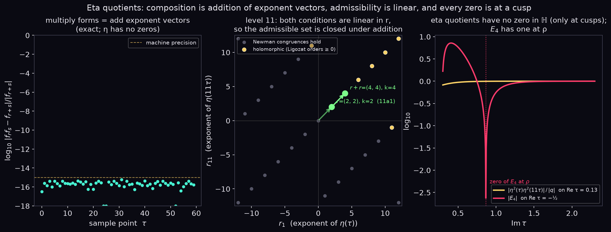

**Eta quotients never vanish.** Products of `η(mτ)` compose by adding exponent vectors, and
none of them has a zero inside the upper half-plane. `Fugue.etaQuotient_ne_zero`

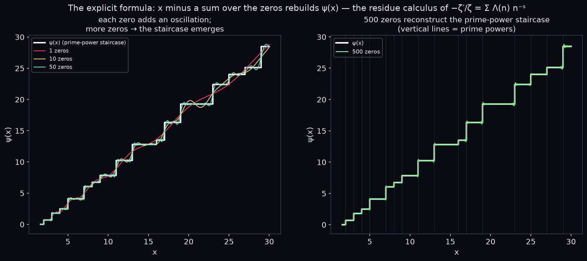

**The zeros rebuild the primes.** Adding the contributions of more and more zeros of `ζ`
reproduces the prime staircase `ψ(x)`. *Proved* (in
[fugue-formal-pnt](https://github.com/rmorleysmith/fugue-formal-pnt)): for `½ ≤ θ < 1`, `ζ` has
no zeros to the right of `θ` exactly when `ψ(x) = x + O(x^{θ+δ})` for every `δ > 0` (Ingham); in
particular the Riemann hypothesis is equivalent to a square-root error term.
`Ingham.zeroFreeRight_iff_psiError`, `Ingham.riemannHypothesis_iff_psiError`

### Also proved here

Ramanujan's congruences `τ(n) ≡ σ₁₁(n) (mod 691)` (`Fugue.tau_congr_691`) and
`p(5n + 4) ≡ 0 (mod 5)` (`Fugue.Partitions.ramanujan_congruence_five`); Jacobi's identity
`∏(1 − qⁿ)³ = Σ (−1)ᵏ (2k + 1) q^{k(k+1)/2}`; Ramanujan's L-function of `Δ` is entire with `Λ(12 − s) = Λ(s)`;
Hecke's functional equation for every `E_k`; Ramanujan's `Σ σ_a(n) σ_b(n) n⁻ˢ` formula; the
primon gas (fermions give `ζ(s)/ζ(2s)`, and `(−1)^F` is `μ`); primes of the form
`x² + xy − y²`; Epstein zeta functions of E8, E8 ⊕ E8, ℤ² and the hexagonal lattice; and the
warm-up case of Bianconi's entropic action. The full list, file by file, is in
[`RESULTS.md`](RESULTS.md).

## The quasi-Riemann library

A second library, `QuasiRH`, works from OpenAI's October 2026 theorem that `ζ` has no zeros with
real part above `7/8`. That theorem is taken as a hypothesis, copied verbatim
(`QuasiRH.OpenAIStatement`); its proof is not imported. From it: zero-free half-planes are
equivalent to the holomorphy of `−ζ′/ζ` (also for every Dirichlet `L`), the Riemann hypothesis is
equivalent to `ZeroFreeRight (1/2)`, and a power-saving error in `ψ(x)` forces a zero-free
region. See [`RESULTS.md`](RESULTS.md).

## Using these results

**Build and check.**

```bash
git clone https://github.com/rmorleysmith/fugue-formal.git
cd fugue-formal
lake exe cache get          # downloads prebuilt Mathlib
lake build                  # about two minutes after the cache
lake env lean Audit.lean    # prints the axioms of every headline result
```

Every line of the audit must read `[propext, Classical.choice, Quot.sound]`; if `sorryAx` ever
appears, something is unproved.

**Depend on it from your own Lake project.** The library is pinned to Lean `v4.34.1` and Mathlib
commit `d13f23b`, the versions used by OpenAI's published proof, so that its statement can be
matched exactly. Your project must use the same versions:

```toml
[[require]]
name = "Formal"
git = "https://github.com/rmorleysmith/fugue-formal.git"
rev = "v1.0.0"
```

**Cite it.** Use GitHub's *Cite this repository* button (from [`CITATION.cff`](CITATION.cff)),
cite a tagged release, and give the Lean name of the result you use. Names are stable within a
release.

## Further reading

| File | What it is |
|---|---|
| [`EXPLAINED.md`](EXPLAINED.md) | every theorem in plain language, with self-test questions |
| [`RESULTS.md`](RESULTS.md) | the full results table, file by file, and what is new relative to Mathlib |
| [`CORPUS-MAP.md`](CORPUS-MAP.md) | each claim of the [audit's ledger](https://github.com/rmorleysmith/fugue) and the Lean name that settles it |
| [`contributions/`](contributions/README.md) | pieces prepared for Mathlib, `formal-conjectures` and the Palomar registry |

## How AI was used

The ideas in this work are Richard Morley-Smith's: the questions, the links between areas of
mathematics, and the choices of what to pursue. AI was used as a tool, in two phases.

- **May–June 2026, the original exploration.** The exploration was carried out in conversation
  with AI coding assistants, chiefly Anthropic's Claude through Claude Code (the design document
  also quotes Google's Gemini). The assistants wrote most of the code, Lean files and documents
  from the author's ideas and direction, quickly and without later editing. Those files are kept
  unchanged in [hsln-archive](https://github.com/rmorleysmith/hsln-archive).
- **October 2026 onwards.** Claude, through Claude Code, helps the author formalise the ideas in
  Lean 4, audit and tidy the earlier files, and write out the working: the steps between an
  intuition and a precise statement. The proofs in this repository were written that way.

Checking the results does not rely on trusting the AI. Every theorem here is verified by the
Lean kernel against Mathlib, and `#print axioms` shows only Lean's three standard axioms.

## Licence

Apache-2.0, the same licence as Mathlib. See [`LICENSE`](LICENSE).
